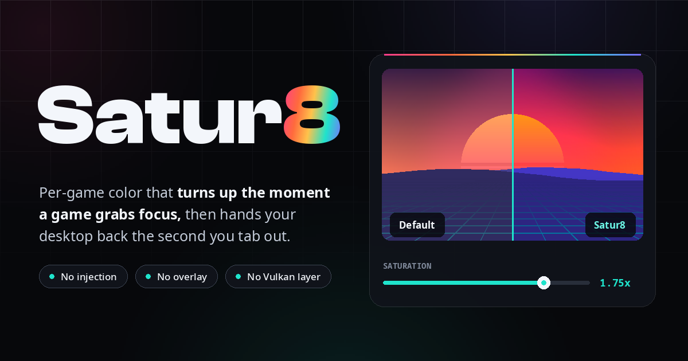
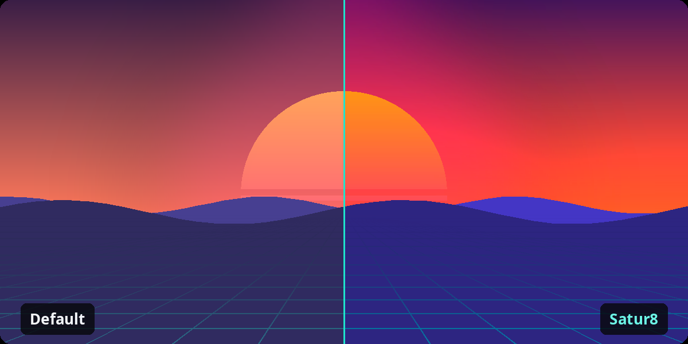
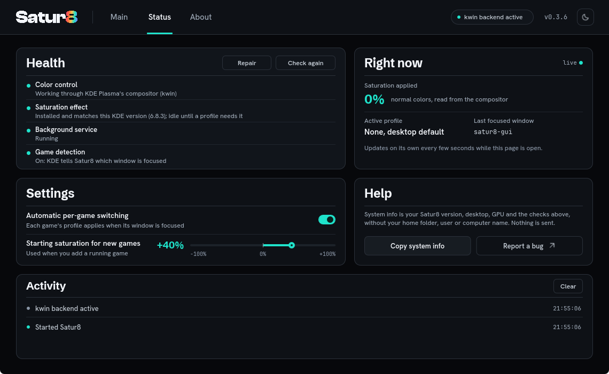

<div align="center">




**Per-game digital vibrance for Linux gaming.**

Boost saturation when your game is focused. Restore your desktop when you leave.  
No game injection. No Vulkan layer. No overlay. Built for modern Linux display stacks.

[Website](https://satur8.app) · [Releases](https://github.com/NtrpyDev/satur8/releases) · [Roadmap](ROADMAP.md) · [Packaging](PACKAGING.md) · [Contributing](CONTRIBUTING.md) · [Issues](https://github.com/NtrpyDev/satur8/issues)


</div>

## What is Satur8?

Satur8 is a Linux app for per-game saturation control.

Create a profile for a game, choose a vibrance level, and Satur8 applies it automatically when the game is focused. When you leave the game, your desktop returns to normal.

It is built for Linux gaming setups that want the punchy color controls common on Windows and NVIDIA, but through Linux-native compositor, driver, and display backends instead of a copied driver panel.

- **Per-game profiles.** Tune saturation per game instead of changing your whole desktop. Profiles match by executable name, window class, or Steam AppID.
- **Follows focus.** The profile applies when the game is focused and your desktop color comes back when you switch away.
- **Outside the game.** No injection, no overlay, no Vulkan layer. See [How it works](#how-it-works).
- **Native Linux backends.** Uses the compositor, driver, or display color path that fits your session, across Wayland and X11, and Steam Game Mode on a Steam Deck. See [Backend support](#backend-support).
- **GUI and CLI.**

## Install

### Fedora (COPR)

The Fedora package is live on [COPR](https://copr.fedorainfracloud.org/coprs/ntrpydev/satur8/), built for Fedora 43, 44 and 45.

```sh
sudo dnf copr enable ntrpydev/satur8
sudo dnf install satur8
```

### Arch (AUR)

Two packages are on the AUR, published and maintained by a community member: [`satur8`](https://aur.archlinux.org/packages/satur8) builds from this repo's source release, and [`satur8-bin`](https://aur.archlinux.org/packages/satur8-bin) installs binaries prebuilt by the package maintainer. Install either with your AUR helper. Because they are community-maintained, they can trail the latest release.

To build the current version yourself, use the packaging files in `packaging/` from a checkout:

```sh
cd packaging
makepkg -si
```

This builds Satur8 from source, including the Rust workspace and the KWin effect.

### Release tarball

Download the latest Linux x86_64 release from the [releases page](https://github.com/NtrpyDev/satur8/releases), then run the installer:

```sh
tar -xzf satur8-*-linux-x86_64.tar.gz
cd satur8-*-linux-x86_64
packaging/install.sh
```

The release tarball needs glibc 2.35 or newer, which Ubuntu 22.04 and later systems have. The v0.4.1 programs were checked by starting each of them in containers of Ubuntu 22.04, Debian 12, Ubuntu 24.04, openSUSE Leap 16.0 and Fedora 43, the desktop app under a virtual display.

The installer needs no root. On KDE Plasma it places the KWin effect in your home directory and adds that directory to KWin's plugin search path, which KWin reads at login, so log out and back in once after the first install.

KWin only loads an effect built for its exact version, so the tarball carries prebuilt effects, each built in that system's own packages: SteamOS 3.9 (KWin 6.7.3), SteamOS 3.10 (KWin 6.8.2), and Fedora 44 and 45 (KWin 6.8.3). The installer uses the one built for your system and KWin version. If there is none, it builds one when `cmake`, a C++ compiler and the Qt 6 and KWin development files are installed. Otherwise it may use an effect built for another system with the same KWin version when your Qt is new enough, and says so; if nothing fits, it skips the effect, tells you why, and installs everything else. `packaging/install.sh --pick-effect` prints what it would choose without changing anything. Nothing is downloaded. KWin 6.5 and older are not covered.

To use the effect without logging out, install it to the system plugin directory instead (uses `sudo`):

```sh
packaging/install.sh --system
```

To uninstall a per-user install:

```sh
packaging/install.sh --uninstall
```

If you clone the source repository instead, the same installer builds and installs Satur8 from source.

On a Steam Deck, see [Steam Deck](#steam-deck).

### Bazzite

Satur8 has not been run on a Bazzite device. Use the release tarball above without `--system`: the installer writes only to your home folder, which Bazzite keeps across updates, and it needs no root. `--system` is refused on Bazzite and other image-based systems.

- Steam Game Mode (the `bazzite-deck` images) uses the same gamescope color and focus features as the Steam Deck. The installer and background service, in v0.4.0 and again in v0.4.1, were run against Bazzite's own gamescope build (3.17.0-ogc1, in Bazzite stable 45.20261117.1) in a container, not on a Bazzite device: the service found gamescope, loaded a profile's table when that app took focus, and removed it at the home window and when stopped. Setup is the same as on the [Steam Deck](#steam-deck).
- KDE Plasma Desktop Mode gets the bundled effect built in Fedora 45's own packages for KWin 6.8.3 (`fedora45-6.8.3`), which Bazzite stable uses. In the Bazzite container the installer picked it and installed it per user; it has not been run on a Bazzite desktop. Bazzite has no build tools, so after a KWin update the effect stays off until you install a newer Satur8 release that includes that KWin version. In the container, a stand-in KWin one patch newer made the installer skip the effect with the reason and install everything else.
- The GNOME images run GNOME 51, which the Satur8 GNOME Shell extension does not list yet.
- The COPR package is built for Fedora 45, which current Bazzite is based on. Installing it on Bazzite by layering it with `rpm-ostree` has not been tested, and Bazzite's documentation treats layering as a last resort.

## Quick start

Start the focus daemon:

```sh
systemctl --user enable --now satur8-daemon
```

On KDE Plasma, turn on the KWin focus script once. It tells the daemon which window is focused, and it is off until you enable it:

```sh
kwriteconfig6 --file kwinrc --group Plugins --key satur8-focusEnabled true
qdbus6 org.kde.KWin /KWin reconfigure
```

Open the desktop app, add a game profile, and set its saturation:

```sh
satur8-gui
```

Launch the game. Satur8 applies the profile when the game is focused and restores your desktop when you switch away.

### Without the focus daemon

On non-KDE sessions, or for manual workflows, use the launch wrapper. It applies a profile, launches the game, and restores on exit. This works as a Steam launch option:

```sh
satur8 run --profile cs2 -- %command%
```

For sessions without a native backend, the gamescope strategies are available:

```sh
satur8 run --via gamescope-native -- %command%   # drive a running gamescope
satur8 run --via gamescope -- %command%          # nested gamescope fallback
```

In Steam Game Mode, use the focus daemon instead; see [Steam Deck](#steam-deck).

## Steam Deck

Satur8 switches saturation per game in Steam Game Mode, and in the Deck's Desktop Mode through KDE Plasma; see [Desktop Mode](#desktop-mode). Both were tested on a Steam Deck OLED with SteamOS 3.9.5, gamescope 3.16.30.1 and KWin 6.7.3.

Satur8 applies the color through gamescope's look table, so Steam's own Color Vibrancy and Color Temperature settings keep working on top of it. Satur8 never changes them.

### Install on the Deck

Open Konsole in Desktop Mode, or connect to the Deck over SSH. Download the latest Linux x86_64 release from the [releases page](https://github.com/NtrpyDev/satur8/releases), then run the per-user installer with the background service turned on:

```sh
tar -xzf satur8-*-linux-x86_64.tar.gz
cd satur8-*-linux-x86_64
packaging/install.sh --enable-daemon
```

Without `--enable-daemon`, the installer prints the command that turns the service on. Everything is installed in your home folder, so it survives SteamOS updates. `--system` is refused on SteamOS. On SteamOS 3.9 the installer prints `Using bundled KWin effect for ABI 6.7.3 (steamos-6.7.3)`; that effect is what Desktop Mode uses. If the installer says the KWin effect was not installed, Game Mode still works without it.

The commands are installed to `~/.local/bin`. An SSH login on SteamOS does not have that folder on its PATH, so over SSH a plain `satur8` gives "command not found"; the installer prints a hint about this. The examples below use the full path, `~/.local/bin/satur8`, which works everywhere. (Konsole in Desktop Mode was not checked.)

### Add a game

List the installed Steam games, then add a profile by the game's name:

```sh
~/.local/bin/satur8 games
~/.local/bin/satur8 profile add sushiamo 1.75 --steam-game sushiamo
```

`satur8 games` shows each game's AppID, name, and profile. `--steam-game` takes the game's name, part of it, or its AppID. If several games match, Satur8 lists them; pass a longer name or the AppID.

On a Deck, profiles match a game by its Steam AppID, and you can also give the AppID yourself. The AppID is the number in the game's `~/.local/share/Steam/steamapps/appmanifest_<AppID>.acf` file name, and in the game's Steam store URL.

```sh
~/.local/bin/satur8 profile add sushiamo 1.75 --steam-app-id 4555040
```

Matching by executable also works for Proton games. Use the Windows executable name, for example `--exe Sushiamo.exe`.

A profile you add or change while the service runs takes effect right away, also for the game that is on screen.

The Steam home screen and games without a profile get `default_saturation` from `~/.config/satur8/profiles.toml`. At 1.0, the default, Satur8 loads nothing there.

### Automatic switching

The background service does the switching. If you installed without `--enable-daemon`, turn it on with:

```sh
systemctl --user enable --now satur8-daemon
```

The service starts with the Game Mode session. This was checked by switching the Deck to Desktop Mode and back; a cold boot was not tested.

In Game Mode, a game's profile loads when the game takes focus and is removed when you leave or close the game. Opening Steam's overlay menu over the game keeps its profile. If the service is killed, systemd restarts it within 5 seconds. Stopping the service puts `default_saturation` back; `~/.local/bin/satur8 off` removes Satur8's table at any value.

### Check it

Over SSH while the Deck is in Game Mode:

```sh
~/.local/bin/satur8 doctor
```

It reports `Steam Game Mode (gamescope on :0)`, whether a Satur8 table is loaded and at what saturation, the focused app's AppID, whether the background service is running, and Steam's own color settings, which Satur8 leaves alone. `~/.local/bin/satur8 status` shows the same. `~/.local/bin/satur8 on`, `set` and `off` also work in Game Mode, including over SSH.

Over SSH, run these checks in Game Mode only. An SSH shell has none of the desktop session's settings, so in Desktop Mode `doctor` over SSH prints a report that does not apply to the desktop.

### The launch option

The `satur8 run --via gamescope-native -- %command%` launch option still works as before. It replaces Steam's color settings while the game runs, and it wins over a profile's table until the game ends. Use the background service instead, and do not use both on one game.

### Desktop Mode

Desktop Mode runs KDE Plasma, which applies Satur8 through its KWin effect. KWin only loads an effect built for its exact version, and SteamOS has no build tools, so the release tarball carries effects built against Valve's own packages: `steamos-6.7.3` for SteamOS 3.9 (the Stable channel) and `steamos-6.8.2` for SteamOS 3.10 (Preview and Main). The installer picks the one for your Deck.

After installing, switch to Desktop Mode once. KWin then loads the effect; no logout is needed beyond that switch. `~/.local/bin/satur8 on 2.0` and `~/.local/bin/satur8 off` then change the whole desktop.

For per-game switching in Desktop Mode, turn on the KWin focus script once while the Deck is in Desktop Mode. These are the commands the installer prints:

```sh
systemctl --user enable --now satur8-daemon
kwriteconfig6 --file kwinrc --group Plugins --key satur8-focusEnabled true
qdbus6 org.kde.KWin /KWin reconfigure
```

A profile then applies while its window has focus, and the desktop comes back when you switch to another window. Desktop programs match by `--exe` or `--window-class`.

After a SteamOS update that changes KWin, the service runs `satur8 repair` at the next session start. It installs the matching effect from the set that came with Satur8, with no network. For a KWin newer than every effect in the set, the effect stays off in Desktop Mode until a newer Satur8 release includes it; Game Mode is not affected.

Desktop Mode is Verified on a Steam Deck OLED with SteamOS 3.9.5 and KWin 6.7.3, measured with a camera on the screen:

- On a full-screen color-bar image, mean saturation was 0.73 with Satur8 off, 0.93 after `satur8 on 2.0`, and 0.73 again after `satur8 off`.
- With a profile at 2.0 for the image viewer, its focused window read 0.93 and another focused window 0.73, following focus back and forth. Removing the profile brought back 0.73.
- With the right effect loaded, the effect file was replaced by one built for another KWin. `satur8 doctor` reported it, and `satur8 repair` installed the 6.7.3 effect from the set while KWin kept running.
- Switching between Game Mode and Desktop Mode several times left Steam's color settings unchanged.

The `steamos-6.8.2` effect for SteamOS 3.10 is included but has not been run on a device.

### Uninstall from the Deck

From the extracted release folder:

```sh
packaging/install.sh --uninstall
```

This stops the service, removes Satur8's table, and removes the commands, the service and the table folder. It was checked on the Deck with a game running and its table loaded: the picture went back to normal. Your profiles in `~/.config/satur8/profiles.toml` are kept, so they come back if you reinstall.

### Not tested yet

- A cold boot of the Deck straight into Game Mode.
- HDR games. By gamescope's source, the look table only changes SDR content, so HDR games are expected to look unchanged. A game presenting SDR does get the look: ELDEN RING through Proton, presenting SDR on the tested Deck, turned grayscale in gamescope's own screenshot.
- An external display.
- The desktop app (`satur8-gui`) on the Deck beyond starting it: it starts in Desktop Mode and shows the KWin backend active, but it was not clicked through.
- The `steamos-6.8.2` effect on a Deck running SteamOS 3.10.
- A Bazzite device (see [Bazzite](#bazzite)) and other systems that run a gamescope session.
- gamescope versions other than 3.16.30.1.

## How it works

Satur8 does not modify the game itself.

Instead, it watches the active window, matches it against your saved profiles, and applies saturation through the best available display backend for your session.


This means the game renders normally. Satur8 changes the final display color pipeline after the frame has already left the game.



The image above is a generated scene shown at normal saturation on the left and Satur8-boosted saturation on the right.

Because Satur8 does not inject into the game process or hook graphics APIs, it avoids the most common anti-cheat risk patterns associated with overlays, DLL injection, or render hooks. This is a description of how Satur8 works, not a promise about what any anti-cheat vendor will allow.

## Backend support

Satur8 chooses the best available backend for your session. Zero per-frame cost paths use hardware or driver display controls. Compositor shader paths are still cheap, but they do work per frame because the compositor shades the final output.

| Environment | Backend | Per-frame cost | Status |
|---|---|---:|---|
| KDE Plasma Wayland | KWin saturation effect | One compositor pass | Verified |
| GNOME Wayland | GNOME Shell shader extension | One compositor pass | Verified |
| X11 with NVIDIA | NV-CONTROL Digital Vibrance | Zero | Verified |
| Hyprland | `hyprctl` shader backend | One compositor pass | Verified |
| DRM/KMS sessions | DRM CTM | Zero | Implemented |
| Steam Game Mode (Steam Deck) | gamescope look table, automatic | Reuses gamescope's color pipeline | Verified on a Steam Deck OLED, SteamOS 3.9.5, gamescope 3.16.30.1 (2026-11-21) |
| Steam Game Mode (Bazzite) | gamescope look table, automatic | Reuses gamescope's color pipeline | Implemented |
| gamescope (running compositor) | gamescope-native color atoms | Reuses existing gamescope | Verified |
| Unsupported Wayland | gamescope nested fallback | Extra nested compositor pass | Verified |

Status legend:

- Verified: tested on real hardware
- Implemented: built and behind environment detection, not yet independently verified

In Steam Game Mode, the focus daemon sets gamescope's look table per game, so Steam's own vibrancy and color temperature keep working on top; see [Steam Deck](#steam-deck). The gamescope-native path is a launch option that drives an already-running gamescope compositor through its Xwayland color override atoms, instead of launching a nested gamescope. While it runs, it replaces Steam's color settings.

## GUI

The screenshots below show the Satur8 GUI.


On the Main page you can:

- Set the desktop vibrance, which is also the default when no game profile is active, and restore the desktop to normal.
- Add a currently running game.
- Set the saturation level per game.
- Enable or disable a profile.



The Status page shows whether each part of Satur8 is working, with a Repair button, and the profile and saturation that are active right now. It also has the switch for automatic per-game switching, the starting saturation for newly added games, and recent activity. Copy system info and Report a bug help with bug reports; nothing is sent automatically. Profiles auto-save the moment you change them. The GUI also ships dark and bright themes and an in-app About page with project links.

Configuration is stored at:

```sh
~/.config/satur8/profiles.toml   # game profiles
~/.config/satur8/gui.toml        # GUI settings such as theme
```

## CLI

Satur8 includes a CLI for scripting, profiles, and debugging.

```sh
satur8 --help
```

Set or clear saturation now:

```sh
satur8 on 1.75      # turn on at 1.75x (1.0 = unchanged, 0 = greyscale)
satur8 off          # restore normal color
satur8 set 2.0      # set an exact value
```

Inspect the environment and backend:

```sh
satur8 status       # environment, chosen backend, and current state
satur8 doctor       # diagnose backend availability
satur8 outputs      # list the outputs the active backend can target
satur8 repair       # put back a KWin effect that fits the running KWin
```

KWin only loads an effect built for its exact version, so a KWin update used to break Satur8 until you reinstalled it. The focus daemon now runs `satur8 repair` at every login. It first installs the matching effect from the set of prebuilt effects that came with Satur8 (copied to `~/.local/share/satur8/kwin-effects`), with no network; only when the set has none does it rebuild the effect from the installed source, which needs `cmake`, a C++ compiler, and the Qt 6 and KWin development files. It also checks the effect file on disk, so a wrong file is replaced even while KWin still uses a copy it loaded earlier, and it says plainly what it will do on a system that cannot build. `satur8 doctor` shows which KWin version each installed copy of the effect was built for and where the effect came from.

Manage per-game profiles:

```sh
satur8 profile add cs2 1.75 --exe cs2 --steam-app-id 730
satur8 games
satur8 games --json
satur8 profile add cs2 1.75 --steam-game cs2
satur8 profile list
satur8 profile show cs2
satur8 profile disable cs2
satur8 profile enable cs2
satur8 profile remove cs2
satur8 profile path
```

A profile needs at least one match rule: `--exe`, `--window-class`, `--steam-app-id`, or `--steam-game`. `satur8 games` lists the installed Steam games and the profile each one uses (`--json` for scripts). `--steam-game` takes a game's name, part of it, or its AppID, and stores the AppID.

## Development

Satur8 is a Rust workspace. The control tools (CLI, daemon, tray, GUI, backends) are Rust; the KWin effect itself is C++ because KWin effects are Qt/KWin plugins.

Build everything:

```sh
cargo build --release
```

Build only the GUI:

```sh
cargo build -p satur8-gui
```

Run the workspace checks:

```sh
cargo check
cargo test --workspace --locked
```

Capture GUI screenshots off-screen (used for these README images):

```sh
SATUR8_GUI_DARK=1 bash assets/gui-shot.sh /tmp/satur8-main.png 0
SATUR8_GUI_DARK=1 bash assets/gui-shot.sh /tmp/satur8-status.png 1
```

Regenerate the rest of the README visuals:

```sh
python3 scripts/generate-readme-assets.py
```

Build the release and source archives:

```sh
packaging/release-tarball.sh
packaging/source-tarball.sh
```

## Roadmap

See [ROADMAP.md](ROADMAP.md) for what ships next: the remaining Steam Deck work and Bazzite support, then a stable 1.0. Distribution status and open packaging work are tracked there and in the [open issues](https://github.com/NtrpyDev/satur8/issues).

## Contributing

Issues and pull requests are welcome. See [CONTRIBUTING.md](CONTRIBUTING.md) for how to build, test, and submit changes.

Before opening a pull request, please make sure the workspace builds (`cargo build`), the checks pass (`cargo check` and `cargo test --workspace --locked`), and any README commands you touched are still accurate.

## License

GPL-3.0-or-later. See [LICENSE](LICENSE).
