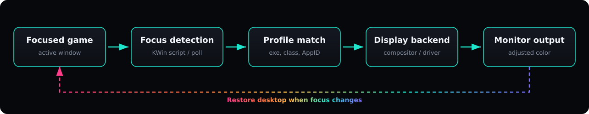
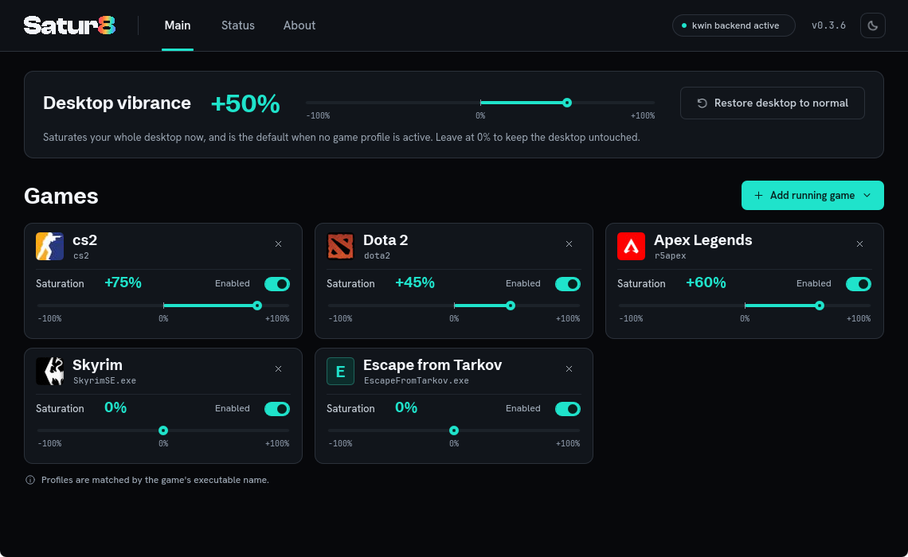

<div align="center">


**Per-game digital vibrance for Linux gaming.**

Boost saturation when your game is focused. Restore your desktop when you leave.  
No game injection. No Vulkan layer. No overlay. Built for modern Linux display stacks.

[Website](https://satur8.app) · [Releases](https://github.com/NtrpyDev/satur8/releases) · [Roadmap](ROADMAP.md) · [Packaging](PACKAGING.md) · [Contributing](CONTRIBUTING.md) · [Issues](https://github.com/NtrpyDev/satur8/issues)


</div>

## What is Satur8?

Satur8 is a Linux app for per-game saturation control.

Create a profile for a game, choose a vibrance level, and Satur8 applies it automatically when the game is focused. When you leave the game, your desktop returns to normal.

It is built for Linux gaming setups that want the punchy color controls common on Windows and NVIDIA, but through Linux-native compositor, driver, and display backends instead of a copied driver panel.

- **Per-game profiles.** Tune saturation per game instead of changing your whole desktop. Profiles match by executable name, window class, or Steam AppID.
- **Follows focus.** The profile applies when the game is focused and your desktop color comes back when you switch away.
- **Outside the game.** No injection, no overlay, no Vulkan layer. See [How it works](#how-it-works).
- **Native Linux backends.** Uses the compositor, driver, or display color path that fits your session, across Wayland and X11, and Steam Game Mode on a Steam Deck. See [Backend support](#backend-support).
- **GUI and CLI.**

## Install

### Fedora (COPR)

The Fedora package is live on [COPR](https://copr.fedorainfracloud.org/coprs/ntrpydev/satur8/), built for Fedora 43, 44 and 45.

```sh
sudo dnf copr enable ntrpydev/satur8
sudo dnf install satur8
```

### Arch (AUR)

Two packages are on the AUR, published and maintained by a community member: [`satur8`](https://aur.archlinux.org/packages/satur8) builds from this repo's source release, and [`satur8-bin`](https://aur.archlinux.org/packages/satur8-bin) installs binaries prebuilt by the package maintainer. Install either with your AUR helper. Because they are community-maintained, they can trail the latest release.

To build the current version yourself, use the packaging files in `packaging/` from a checkout:

```sh
cd packaging
makepkg -si
```

This builds Satur8 from source, including the Rust workspace and the KWin effect.

### Release tarball

Download the latest Linux x86_64 release from the [releases page](https://github.com/NtrpyDev/satur8/releases), then run the installer:

```sh
tar -xzf satur8-*-linux-x86_64.tar.gz
cd satur8-*-linux-x86_64
packaging/install.sh
```

The release tarball needs glibc 2.35 or newer, which Ubuntu 22.04 and later systems have. The v0.4.1 programs were checked by starting each of them in containers of Ubuntu 22.04, Debian 12, Ubuntu 24.04, openSUSE Leap 16.0 and Fedora 43, the desktop app under a virtual display.

The installer needs no root. On KDE Plasma it places the KWin effect in your home directory and adds that directory to KWin's plugin search path, which KWin reads at login, so log out and back in once after the first install.

KWin only loads an effect built for its exact version, so the tarball carries prebuilt effects, each built in that system's own packages: SteamOS 3.9 (KWin 6.7.3), SteamOS 3.10 (KWin 6.8.2), and Fedora 44 and 45 (KWin 6.8.3). The installer uses the one built for your system and KWin version. If there is none, it builds one when `cmake`, a C++ compiler and the Qt 6 and KWin development files are installed. Otherwise it may use an effect built for another system with the same KWin version when your Qt is new enough, and says so; if nothing fits, it skips the effect, tells you why, and installs everything else. `packaging/install.sh --pick-effect` prints what it would choose without changing anything. Nothing is downloaded. KWin 6.5 and older are not covered.

To use the effect without logging out, install it to the system plugin directory instead (uses `sudo`):

```sh
packaging/install.sh --system
```

To uninstall a per-user install:

```sh
packaging/install.sh --uninstall
```

If you clone the source repository instead, the same installer builds and installs Satur8 from source.

On a Steam Deck, see [Steam Deck](#steam-deck).

### Bazzite

Use the release tarball above without `--system`: the installer writes only to your home folder, which Bazzite keeps across updates, and it needs no root. `--system` is refused on Bazzite and other image-based systems. Setup in Steam Game Mode is the same as on the [Steam Deck](#steam-deck).

What has been checked, and on what:

- **Steam Game Mode with NVIDIA, on real hardware.** A desktop with an RTX 3070 Ti (NVIDIA driver 620.70.06, open kernel module) running `bazzite-deck-nvidia` stable 45.20261117.1 with gamescope 3.17.0. The installer, the background service, per-game switching and a reboot with nobody touching it worked. Read from the image the display actually shows: a fullscreen test game with a profile shows the look while it is in front, and its own colors again when Steam is in front or the service stops.
- **Why NVIDIA needed a change.** gamescope colors a game it shows directly, without a composite pass, only through AMD's display color hardware. On any other GPU, Satur8 now tells gamescope to composite every frame while a Satur8 look is on. That costs one extra GPU pass per frame while the look is on, and nothing otherwise. Before v0.5.2 a fullscreen game on NVIDIA kept its own colors even though `satur8 status` said the look was loaded. `satur8 doctor` says whether the look is on screen.
- **Steam Game Mode with AMD: only in a virtual machine.** `bazzite-deck` stable 45.20261117.1 in a virtual machine on an AMD Radeon RX 9070, not a Bazzite device. Install, service, per-game switching, and the app's Game Mode layout (the Games and Status pages and the Add a game list, driven by keys standing in for the buttons) were seen on the virtual machine's screen. No Steam account was used, so the games list was empty and Satur8 could not add its Steam library entry; it said there is no Steam user. The controller was not tested.
- **Intel: not tested.** No Intel Bazzite hardware was available. By gamescope's source the NVIDIA change covers Intel the same way.
- **KDE Plasma Desktop Mode.** The tarball's bundled effect is built in Fedora 45's own packages for KWin 6.8.3 (`fedora45-6.8.3`), which Bazzite stable and testing use. On the NVIDIA desktop, `satur8 on 2.0`, `satur8 set 0` and `satur8 off` changed the image the display shows, and the focus script loaded. In a KDE virtual machine with software rendering, from v0.4.0: per-game switching followed window focus, `satur8 repair` put the right effect back after a wrong file was placed there, and the service and effect came back after a reboot with nobody touching it.
- **After a KWin update.** Bazzite has no build tools, so after a KWin update the effect stays off until a Satur8 release bundles an effect for that KWin. `satur8 repair` then says so and how to check a newer release: `packaging/install.sh --pick-effect` in the unpacked release says whether it has one, without changing anything. Steam Game Mode does not use the effect. No KWin update was on offer to test (stable and testing both had KWin 6.8.3 on 2026-11-22); the message was checked by putting an effect for another KWin in place.
- **The COPR package, layered.** Bazzite's documentation calls `rpm-ostree` layering a last resort, and the tarball's per-user install above is the way to use Satur8 on Bazzite. What was seen in the KDE virtual machine (2026-11-22): `sudo dnf5 copr enable ntrpydev/satur8`, then `rpm-ostree install satur8` and a reboot, installed satur8 0.5.0 from COPR plus 31 packages its recommendations pull in (among them cmake, gcc-c++, and the KWin and Qt development files). The system-wide effect loaded, `satur8 on 2.0` and `satur8 off` changed a test window, and the service, once turned on with `systemctl --user enable --now satur8-daemon`, came back after a reboot with nobody touching it. After switching that install to the testing image (45.20261122.4, still KWin 6.8.3) the package stayed layered and the same checks passed. Whether `satur8 repair` can build an effect with the layered tools after a KWin update was not checked.
- The GNOME images run GNOME 51. From v0.4.1, the Satur8 GNOME Shell extension lists GNOME 51. It was checked on GNOME Shell 51.1 headless in a Fedora 45 container, not on a Bazzite device or a GNOME 51 desktop.

Known limits on Bazzite:

- On a GPU that is not AMD, a Satur8 look in Steam Game Mode costs one extra GPU pass per frame while it is on.
- If you start gamescope with `ENABLE_VKBASALT=1`, Satur8 cannot see that on Bazzite, because only root can read gamescope's environment there, so taking a Satur8 look off can also end the composite pass vkBasalt relies on until gamescope restarts.
- Satur8 assumes every AMD GPU lets gamescope color a game it shows directly; an AMD GPU on a kernel without AMD's extra display color controls would need the same composite pass, and that case was not checked.

## Quick start

Turn on automatic per-game switching:

```sh
satur8 auto on
```

That starts the focus daemon now and at login. On KDE Plasma it also turns on the KWin focus script, which tells the daemon which window is focused, and asks KWin to load it. It is what the switch on the desktop app's Status page does; `satur8 auto off` reverses it and `satur8 auto status` says whether it is on.

The same by hand, if you need it: `systemctl --user enable --now satur8-daemon`, then on KDE Plasma `kwriteconfig6 --file kwinrc --group Plugins --key satur8-focusEnabled true` and `qdbus6 org.kde.KWin /KWin reconfigure` (on Fedora and Bazzite the last tool is named `qdbus-qt6`; the installer prints the command with the name your system has).

Open the desktop app, add a game profile, and set its saturation:

```sh
satur8-gui
```

Launch the game. Satur8 applies the profile when the game is focused and restores your desktop when you switch away.

### Without the focus daemon

On non-KDE sessions, or for manual workflows, use the launch wrapper. It applies a profile, launches the game, and restores on exit. This works as a Steam launch option:

```sh
satur8 run --profile cs2 -- %command%
```

For sessions without a native backend, the gamescope strategies are available:

```sh
satur8 run --via gamescope-native -- %command%   # drive a running gamescope
satur8 run --via gamescope -- %command%          # nested gamescope fallback
```

In Steam Game Mode, use the focus daemon instead; see [Steam Deck](#steam-deck).

## Steam Deck

Satur8 switches saturation per game in Steam Game Mode, and in the Deck's Desktop Mode through KDE Plasma; see [Desktop Mode](#desktop-mode). Both were tested on a Steam Deck OLED with SteamOS 3.9.5, gamescope 3.16.30.1 and KWin 6.7.3.

Satur8 applies the color through gamescope's look table, so Steam's own Color Vibrancy and Color Temperature settings keep working on top of it. Satur8 never changes them.

### Install on the Deck

Open Konsole in Desktop Mode, or connect to the Deck over SSH. Download the latest Linux x86_64 release from the [releases page](https://github.com/NtrpyDev/satur8/releases), then run the per-user installer with the background service turned on:

```sh
tar -xzf satur8-*-linux-x86_64.tar.gz
cd satur8-*-linux-x86_64
packaging/install.sh --enable-daemon
```

Without `--enable-daemon`, the installer prints the command that turns the service on. Everything is installed in your home folder, so it survives SteamOS updates. `--system` is refused on SteamOS. On SteamOS 3.9 the installer prints `Using bundled KWin effect for ABI 6.7.3 (steamos-6.7.3)`; that effect is what Desktop Mode uses. If the installer says the KWin effect was not installed, Game Mode still works without it.

From v0.5.1 there is also a [Decky Loader](https://decky.xyz) plugin, for Decky users who want to stay in Game Mode. Its panel in the Quick Access Menu says whether Satur8 is installed and which version, installs or updates it (it downloads the release from GitHub, checks its SHA-256, and runs this same installer as your user with the background service turned on), reinstalls it as a repair, and opens the app. To get it, open Decky's settings, then Developer, then Install Plugin from URL, and enter `https://github.com/NtrpyDev/satur8/releases/latest/download/satur8-decky-plugin.zip`. It is not on the official Decky store; if DeckyHub lists it, it can be installed from there too. Checked on a Steam Deck OLED with Decky Loader v3.3.1: the panel loads and Open Satur8 starts the app. Installing, updating and reinstalling from the plugin can only be checked against a published release, so that is checked after v0.5.1 is out. Its source and details are in [decky-plugin/](decky-plugin/).

The commands are installed to `~/.local/bin`. An SSH login on SteamOS does not have that folder on its PATH, so over SSH a plain `satur8` gives "command not found"; the installer prints a hint about this. The examples below use the full path, `~/.local/bin/satur8`, which works everywhere. (Konsole in Desktop Mode was not checked.)

### The app in Game Mode

In Game Mode, Steam shows only programs started from its library, so the app needs an entry there. On a system with a Steam gaming session the installer asks Steam to add it (`satur8 steam-shortcut add`; `--no-steam-entry` skips this). It never adds a second entry, and it says what it did or why it could not, for example when Steam is not running. Then open **Satur8** from the Non-Steam section of the library. No Desktop Mode, terminal or typing is needed after the install.

There the app has its own layout for the Deck's screen and controls, not the desktop window made smaller:

- **General** is the first row: Steam's own screens and every game without a row of its own. It is what the desktop app calls Desktop vibrance.
- **Add a game** lists your installed Steam games by name. A game that is running is first and says so. Pick one and it gets a row, matched by its Steam AppID.
- Each game has a row with its value, an on/off switch, a remove button that asks first, and a wide slider. Tap the track or drag along it; dragging up or down scrolls the page instead. A game whose row is switched off shows its normal colors, not the General value.
- The Deck's buttons work: the D-pad or left stick moves a highlight, A selects (on a slider, A then left and right change it), B goes back or undoes, X turns the game on or off, Y opens the list, L1 and R1 change page, L2 and R2 change the row's slider by one. A bar along the bottom says what the buttons do at that moment.

A game's setting shows while that game is on screen. While Satur8 itself is on screen you see General, so switch back to the game to see its setting.

The entry's artwork is put in place by `satur8 steam-shortcut artwork`, and by the app the first time it is started from the library; Steam shows new artwork after it restarts. `satur8 steam-shortcut status` says whether the entry is there and with which AppID.

What was checked: this layout was run on a virtual 1280x800 screen with a Steam Deck's Game Mode environment, with pointer presses and drags standing in for touch and keys standing in for the buttons, and started inside the Steam Linux Runtime container that Steam runs it in. It has not yet been run on a Deck, and the gamepad reader has not read a real pad. On a Deck, an earlier build confirmed the cause this layout fixes: the app used to open larger than the screen, so only its top left could be touched.

If the buttons do nothing, create an empty file `~/.config/satur8/input-debug`, start the app from the library, press a few buttons, and look at `~/.local/state/satur8/input-debug.log`: it lists the input devices the app could open, which one it took for a gamepad, and each press it read.

### Add a game from the command line

List the installed Steam games, then add a profile by the game's name:

```sh
~/.local/bin/satur8 games
~/.local/bin/satur8 profile add sushiamo 1.75 --steam-game sushiamo
```

`satur8 games` shows each game's AppID, name, and profile. `--steam-game` takes the game's name, part of it, or its AppID. If several games match, Satur8 lists them; pass a longer name or the AppID.

On a Deck, profiles match a game by its Steam AppID, and you can also give the AppID yourself. The AppID is the number in the game's `~/.local/share/Steam/steamapps/appmanifest_<AppID>.acf` file name, and in the game's Steam store URL.

```sh
~/.local/bin/satur8 profile add sushiamo 1.75 --steam-app-id 4555040
```

Matching by executable also works for Proton games. Use the Windows executable name, for example `--exe Sushiamo.exe`.

A profile you add or change while the service runs takes effect right away, also for the game that is on screen.

The Steam home screen and games without a profile get `default_saturation` from `~/.config/satur8/profiles.toml`. At 1.0, the default, Satur8 loads nothing there. A game whose profile is disabled gets neither its profile's value nor `default_saturation`: it shows its normal colors (1.0).

### Automatic switching

The background service does the switching. If you installed without `--enable-daemon`, turn it on with the switch on the app's Status page, or with:

```sh
~/.local/bin/satur8 auto on
```

By hand that is `systemctl --user enable --now satur8-daemon`.

The service starts with the Game Mode session. This was checked by switching the Deck to Desktop Mode and back, and by restarting the Deck with v0.4.1 installed: with nobody touching it, the service was running in Game Mode about ten seconds after boot and Steam's color settings were unchanged.

In Game Mode, a game's profile loads when the game takes focus and is removed when you leave or close the game. Opening Steam's overlay menu over the game keeps its profile. If the service is killed, systemd restarts it within 5 seconds. Stopping the service puts `default_saturation` back; `~/.local/bin/satur8 off` removes Satur8's table at any value.

### Check it

Over SSH while the Deck is in Game Mode:

```sh
~/.local/bin/satur8 doctor
```

It reports `Steam Game Mode (gamescope on :0)`, whether a Satur8 table is loaded and at what saturation, the focused app's AppID, whether the background service is running, and Steam's own color settings, which Satur8 leaves alone. `~/.local/bin/satur8 status` shows the same. `~/.local/bin/satur8 on`, `set` and `off` also work in Game Mode, including over SSH.

Over SSH, run these checks in Game Mode only. An SSH shell has none of the desktop session's settings, so in Desktop Mode `doctor` over SSH prints a report that does not apply to the desktop.

### The launch option

The `satur8 run --via gamescope-native -- %command%` launch option still works as before. It replaces Steam's color settings while the game runs, and it wins over a profile's table until the game ends. Use the background service instead, and do not use both on one game.

### Desktop Mode

Desktop Mode runs KDE Plasma, which applies Satur8 through its KWin effect. KWin only loads an effect built for its exact version, and SteamOS has no build tools, so the release tarball carries effects built against Valve's own packages: `steamos-6.7.3` for SteamOS 3.9 (the Stable channel) and `steamos-6.8.2` for SteamOS 3.10 (Preview and Main). The installer picks the one for your Deck.

After installing, switch to Desktop Mode once. KWin then loads the effect; no logout is needed beyond that switch. `~/.local/bin/satur8 on 2.0` and `~/.local/bin/satur8 off` then change the whole desktop.

For per-game switching in Desktop Mode, turn it on once while the Deck is in Desktop Mode, with the switch on the app's Status page or with the command the installer prints:

```sh
~/.local/bin/satur8 auto on
```

By hand that is `systemctl --user enable --now satur8-daemon`, `kwriteconfig6 --file kwinrc --group Plugins --key satur8-focusEnabled true` and `qdbus6 org.kde.KWin /KWin reconfigure`.

A profile then applies while its window has focus, and the desktop comes back when you switch to another window. Desktop programs match by `--exe` or `--window-class`.

After a SteamOS update that changes KWin, the service runs `satur8 repair` at the next session start. It installs the matching effect from the set that came with Satur8, with no network. For a KWin newer than every effect in the set, the effect stays off in Desktop Mode until a newer Satur8 release includes it; Game Mode is not affected.

Desktop Mode is Verified on a Steam Deck OLED with SteamOS 3.9.5 and KWin 6.7.3, measured with a camera on the screen:

- On a full-screen color-bar image, mean saturation was 0.73 with Satur8 off, 0.93 after `satur8 on 2.0`, and 0.73 again after `satur8 off`.
- With a profile at 2.0 for the image viewer, its focused window read 0.93 and another focused window 0.73, following focus back and forth. Removing the profile brought back 0.73.
- With the right effect loaded, the effect file was replaced by one built for another KWin. `satur8 doctor` reported it, and `satur8 repair` installed the 6.7.3 effect from the set while KWin kept running.
- Switching between Game Mode and Desktop Mode several times left Steam's color settings unchanged.

The `steamos-6.8.2` effect for SteamOS 3.10 is included. It has not been run on a Deck; in a headless KWin 6.8.2 session built from Valve's SteamOS 3.10 packages, with software rendering, it changed window colors by the same values as the `steamos-6.7.3` effect does on KWin 6.7.3.

### Uninstall from the Deck

From the extracted release folder:

```sh
packaging/install.sh --uninstall
```

This stops the service, removes Satur8's table, and removes the commands, the service and the table folder. It was checked on the Deck with a game running and its table loaded: the picture went back to normal. Your profiles in `~/.config/satur8/profiles.toml` are kept, so they come back if you reinstall.

Satur8's entry stays in your Steam library, because Steam has no command to remove one; the uninstaller says so and takes Satur8's artwork off it. To remove the entry, select it in the Steam library, open its settings (the gear), then Manage, then "Remove non-Steam game from your library". (This part of the uninstaller was not run on a Deck.)

### Known: gamescope can abort when Game Mode ends

On the tested Deck, gamescope sometimes aborts while Game Mode shuts down for the switch to Desktop Mode. The switch still completes. This happens without Satur8: in repeated trials a session that never had a Satur8 table aborted the same way (1 of 8 sessions without a table, 2 of 6 with one, too few to say whether a table changes the odds). All the aborts have one signature, two threads of gamescope 3.16.30.1 using the session's D-Bus connection at the same time during shutdown, and Satur8's Game Mode code does not use that connection. No abort was seen while a game was running.

### Not tested yet

- HDR games. By gamescope's source, the look table only changes SDR content, so HDR games are expected to look unchanged. A game presenting SDR does get the look: ELDEN RING through Proton, presenting SDR on the tested Deck, turned grayscale in gamescope's own screenshot.
- An external display.
- The app's Game Mode layout on a Deck, with touch and with the controller (see [The app in Game Mode](#the-app-in-game-mode)).
- The desktop app (`satur8-gui`) in Desktop Mode beyond starting it: it starts there and shows the KWin backend active, but it was not clicked through.
- The `steamos-6.8.2` effect on a Deck running SteamOS 3.10 (it was only run headless, see above).
- Bazzite on an AMD or Intel device (see [Bazzite](#bazzite)), and other systems that run a gamescope session.
- gamescope versions other than 3.16.30.1.

## How it works

Satur8 does not modify the game itself.

Instead, it watches the active window, matches it against your saved profiles, and applies saturation through the best available display backend for your session.



This means the game renders normally. Satur8 changes the final display color pipeline after the frame has already left the game.


The image above is a generated scene shown at normal saturation on the left and Satur8-boosted saturation on the right.

Because Satur8 does not inject into the game process or hook graphics APIs, it avoids the most common anti-cheat risk patterns associated with overlays, DLL injection, or render hooks. This is a description of how Satur8 works, not a promise about what any anti-cheat vendor will allow.

## Backend support

Satur8 chooses the best available backend for your session. Zero per-frame cost paths use hardware or driver display controls. Compositor shader paths are still cheap, but they do work per frame because the compositor shades the final output.

| Environment | Backend | Per-frame cost | Status |
|---|---|---:|---|
| KDE Plasma Wayland | KWin saturation effect | One compositor pass | Verified |
| KDE Plasma Wayland, a different value per output | KWin saturation effect | One compositor pass | Implemented |
| GNOME Wayland | GNOME Shell shader extension | One compositor pass | Verified |
| X11 with NVIDIA | NV-CONTROL Digital Vibrance | Zero | Verified |
| Hyprland | `hyprctl` shader backend | One compositor pass | Verified |
| DRM/KMS sessions (a console with no display server) | DRM CTM | Zero | Verified on a Steam Deck OLED's AMD GPU (2026-11-22) |
| Steam Game Mode (Steam Deck) | gamescope look table, automatic | Reuses gamescope's color pipeline | Verified on a Steam Deck OLED, SteamOS 3.9.5, gamescope 3.16.30.1 (2026-11-21) |
| Steam Game Mode (Bazzite) | gamescope look table, automatic | Reuses gamescope's color pipeline on AMD; one composite pass per frame while a look is on with other GPUs | Verified on an RTX 3070 Ti, Bazzite 45.20261117.1 (2026-11-22); AMD only in a virtual machine |
| gamescope (running compositor) | gamescope-native color atoms | Reuses existing gamescope | Verified |
| Unsupported Wayland | gamescope nested fallback | Extra nested compositor pass | Verified |

Status legend:

- Verified: tested on real hardware
- Implemented: built and behind environment detection, not yet independently verified

KDE Plasma is Verified for one value on every output. A different value per output is new in v0.5.0 and is Implemented, not Verified: it was checked on headless KWin with two virtual outputs and software rendering, in pixels on KWin 6.7.3, 6.8.2 and 6.8.3, and on a real KWin 6.8.3 session with three monitors the focus script reported which monitor a window was on as it moved. A different value on each of several real monitors has not been seen yet. See [Multiple monitors](#multiple-monitors).

In Steam Game Mode, the focus daemon sets gamescope's look table per game, so Steam's own vibrancy and color temperature keep working on top; see [Steam Deck](#steam-deck). The gamescope-native path is a launch option that drives an already-running gamescope compositor through its Xwayland color override atoms, instead of launching a nested gamescope. While it runs, it replaces Steam's color settings.

## GUI

The screenshots below show the Satur8 GUI.



On the Main page you can:

- Set the desktop vibrance, which games without a profile also get, and restore the desktop to normal.
- Add a game from one list of your games by name: installed Steam games, with any that is running first. Launchers and other background programs are not listed.
- Set the saturation level per game.
- Enable or disable a profile. A game whose profile is disabled shows its normal colors, not the desktop vibrance.


The Status page shows whether each part of Satur8 is working, with a Repair button, and the profile and saturation that are active right now. It also has the switch for automatic per-game switching, the starting saturation for newly added games, and recent activity. Copy system info and Report a bug help with bug reports; nothing is sent automatically. Profiles auto-save the moment you change them. The GUI also ships dark and bright themes and an in-app About page with project links.

Configuration is stored at:

```sh
~/.config/satur8/profiles.toml   # game profiles
~/.config/satur8/gui.toml        # GUI settings such as theme
```

## CLI

Satur8 includes a CLI for scripting, profiles, and debugging.

```sh
satur8 --help
```

Set or clear saturation now:

```sh
satur8 on 1.75      # turn on at 1.75x (1.0 = unchanged, 0 = greyscale)
satur8 off          # restore normal color
satur8 set 2.0      # set an exact value
```

Turn automatic per-game switching on or off, the way the switch on the app's Status page does:

```sh
satur8 auto on      # the background service now and at login; on KDE Plasma also the KWin focus script
satur8 auto off     # the reverse
satur8 auto status  # say whether it is on
```

Inspect the environment and backend:

```sh
satur8 status       # environment, chosen backend, and current state
satur8 doctor       # diagnose backend availability
satur8 outputs      # list the outputs the active backend can target, and what it can do with them
satur8 repair       # put back a KWin effect that fits the running KWin
```

KWin only loads an effect built for its exact version, so a KWin update used to break Satur8 until you reinstalled it. The focus daemon now runs `satur8 repair` at every login. It first installs the matching effect from the set of prebuilt effects that came with Satur8 (copied to `~/.local/share/satur8/kwin-effects`), with no network; only when the set has none does it rebuild the effect from the installed source, which needs `cmake`, a C++ compiler, and the Qt 6 and KWin development files. It also checks the effect file on disk, so a wrong file is replaced even while KWin still uses a copy it loaded earlier, and it says plainly what it will do on a system that cannot build. `satur8 doctor` shows which KWin version each installed copy of the effect was built for and where the effect came from.

On GNOME, `satur8 doctor` checks the Satur8 GNOME Shell extension instead: where it is installed, which GNOME versions it lists, the state GNOME Shell reports for it, and whether Satur8 can apply, and it ends with the one thing to do next. `satur8 status` shows the short form.

Manage per-game profiles:

```sh
satur8 profile add cs2 1.75 --exe cs2 --steam-app-id 730
satur8 games
satur8 games --json
satur8 profile add cs2 1.75 --steam-game cs2
satur8 profile list
satur8 profile show cs2
satur8 profile disable cs2
satur8 profile enable cs2
satur8 profile remove cs2
satur8 profile path
```

A disabled profile still belongs to its game: while it is disabled the game shows its normal colors (1.0), not the default saturation. Remove the profile to give the game the default saturation again.

A profile needs at least one match rule: `--exe`, `--window-class`, `--steam-app-id`, or `--steam-game`. `satur8 games` lists the installed Steam games and the profile each one uses (`--json` for scripts). `--steam-game` takes a game's name, part of it, or its AppID, and stores the AppID.

Satur8's own entry in the Steam library, which is how the app is opened in Steam Game Mode (see [The app in Game Mode](#the-app-in-game-mode)):

```sh
satur8 steam-shortcut status             # is the entry there, and with which AppID
satur8 steam-shortcut add                # ask Steam to add it, unless it is there
satur8 steam-shortcut artwork            # put its artwork in place
satur8 steam-shortcut artwork --remove   # take that artwork away again
```

`add` uses SteamOS's `steamos-add-to-steam` and needs Steam running; on a system without that tool it says how to add the entry in Steam. These commands read Steam's shortcuts file and never write it.

### Multiple monitors

By default every setting applies to every output, as it always has. On KDE Plasma, Satur8 can also give each output its own value. This is new in v0.5.0: it was checked on headless KWin with two virtual outputs and software rendering, in pixels on KWin 6.7.3, 6.8.2 and 6.8.3, and on a real KWin 6.8.3 session with three monitors the focus script reported which monitor a window was on as it moved. A different value on each of several real monitors has not been seen yet. Every other desktop applies one saturation to every output, and `satur8 outputs`, `satur8 doctor` and `satur8 status` say so when the file asks for more.

Outputs are named by port, as `satur8 outputs` lists them (for example `DP-2` or `HDMI-A-1`), so a setting follows the port, not the monitor.

```sh
satur8 outputs                          # each output, its value now, and what game profiles change
satur8 outputs default HDMI-A-1 0.85    # this output's value when no game profile is changing it
satur8 outputs default HDMI-A-1 --unset # back to default_saturation
satur8 outputs follow focused           # game profiles change only the output the game is on
satur8 outputs follow all               # game profiles change every output (the default)
satur8 profile add couch 1.3 --exe hades --output HDMI-A-1   # repeatable; `all` means every output
satur8 on 1.3 --output DP-2             # this output only, now; the same as `satur8 set 1.3 --output DP-2`
satur8 profile list                     # a profile that names outputs lists them as outputs=HDMI-A-1
satur8 status                           # names the output when the active profile is limited to one
```

The same settings in `~/.config/satur8/profiles.toml`:

```toml
default_saturation = 1.0
profile_outputs = "focused"      # absent means "all"

[output."HDMI-A-1"]
default_saturation = 0.85

[[profile]]
name = "couch"
saturation = 1.3
exe = "hades"
outputs = ["HDMI-A-1"]
```

- With `profile_outputs = "focused"`, a profile that lists no outputs changes only the output the game window is on, and moves with the window. A window across two outputs takes one value, from the output KWin assigns it to. When the output is unknown, for example after an upgrade until the next login, the profile changes every output and the daemon logs why.
- On KDE Plasma, an output that is not connected keeps its setting, and it applies as soon as the output is plugged in.
- `satur8 set 1.3 --output DP-2` changes only that output on KDE Plasma and leaves the others as they are; `satur8 set 1.3` and `satur8 off` still change every output. A desktop that shows one saturation everywhere refuses `--output NAME`, as before.
- After upgrading, log out and back in once: KWin keeps the effect and the focus script it loaded at login, and until it loads the new ones Satur8 applies one value to every output. `satur8 outputs` says so until then, and so do `satur8 doctor` and `satur8 status` when the file uses per-output settings.
- A Satur8 older than this one loads a file with these settings and ignores them, but if it saves the file (any `satur8 profile` change or the desktop app) it writes it back without them.

## Development

Satur8 is a Rust workspace. The control tools (CLI, daemon, tray, GUI, backends) are Rust; the KWin effect itself is C++ because KWin effects are Qt/KWin plugins.

Build everything:

```sh
cargo build --release
```

Build only the GUI:

```sh
cargo build -p satur8-gui
```

Run the workspace checks:

```sh
cargo check
cargo test --workspace --locked
```

Capture GUI screenshots off-screen (used for these README images):

```sh
SATUR8_GUI_DARK=1 bash assets/gui-shot.sh /tmp/satur8-main.png 0
SATUR8_GUI_DARK=1 bash assets/gui-shot.sh /tmp/satur8-status.png 1
```

Regenerate the rest of the README visuals:

```sh
python3 scripts/generate-readme-assets.py
```

Build the release and source archives:

```sh
packaging/release-tarball.sh
packaging/source-tarball.sh
```

## Roadmap

See [ROADMAP.md](ROADMAP.md) for what ships next: the remaining Steam Deck work and Bazzite support, then a stable 1.0. Distribution status and open packaging work are tracked there and in the [open issues](https://github.com/NtrpyDev/satur8/issues).

## Contributing

Issues and pull requests are welcome. See [CONTRIBUTING.md](CONTRIBUTING.md) for how to build, test, and submit changes.

Before opening a pull request, please make sure the workspace builds (`cargo build`), the checks pass (`cargo check` and `cargo test --workspace --locked`), and any README commands you touched are still accurate.

## License

GPL-3.0-or-later. See [LICENSE](LICENSE).
